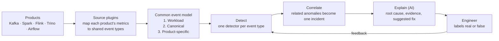
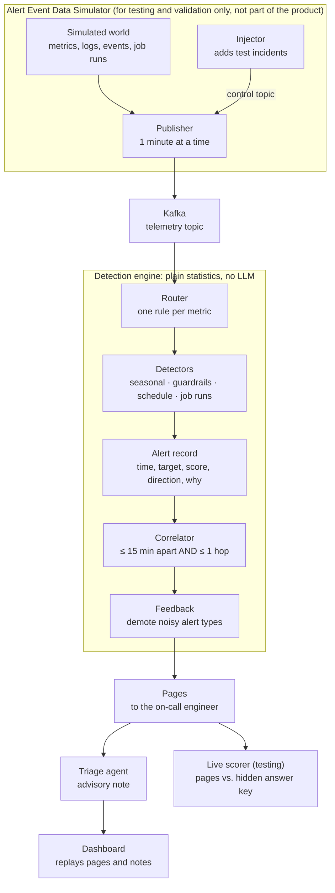
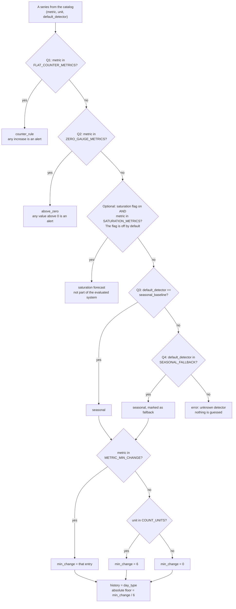

# Sentinel Lens: AI-Assisted Anomaly Detection for the Data Platform

**An executive overview of the approach, the implementation and the results**

*SRE internship portfolio project · November 2026 · Code: [github.com/pgopalabhatla/sentinel-lens](https://github.com/pgopalabhatla/sentinel-lens)*

---

## Executive summary

Sentinel Lens reads the metrics and job runs of a data platform and flags readings that are far from their usual value for that hour and day. It groups related alerts into one page for the on-call engineer and says in one line why it fired. I built it because alerting on every metric buries engineers in false alarms. The long-term aim is AI-assisted anomaly detection across every data platform product, so SRE teams write fewer alert rules and find causes faster.

This phase built and validated the **detection core**. That covers explainable statistical detectors, grouping alerts into incidents, a feedback loop that learns from engineers, and an AI triage note on each page.

| What matters | Result |
| --- | --- |
| Real incidents caught on a held-out test week | **9 of 10** |
| False alerts, compared with a simple baseline detector | **641 → 45 (93% fewer)** |
| Share of alerts that were real (precision) | **0.26 → 0.79** (real ÷ (real + false): 169 of 214; the 10 alerts on a planned traffic burst count as neither) |
| Raw alerts grouped into pages to an engineer | **1,445 → 24** in one week (batch result) |
| False pages per day, in the Attacker live week | **0.29** |
| Results held on additional held-out weeks | **12 of 14** (Scripted live week) and **9 of 11** (Attacker live week) detected |

The AI has no say in paging. Pages come from plain statistics that I can check by hand, with no model involved. After a page goes out, a triage agent examines it with read-only tools and writes a brief note: whether a human needs to look, the likely cause, the impact, and a next step. If the triage agent is wrong, the page has already gone out.

---

## 1. The problem

Modern data platforms such as Kafka, Spark, Flink, Trino and Airflow on Kubernetes report a very large number of health metrics. The obvious way to monitor them is a statistical alarm on every metric. In this project that simple approach did catch every real problem, but it also:

- raised about **125 alerts a day**, and
- **3 in 4 of them were false**.

An on-call engineer would stop reading them, and a real incident would get lost in the pile. So I aimed to cut false alerts sharply while still catching nearly everything. On the test week the false alerts went from 641 to 45, a 93% drop, and I caught 9 of the 10 real incidents; the simple baseline caught all 10. The one miss was the cost of a rule that removed many false alarms; I found it on the test week and kept the result as it was.

One alerting rule can't fit every kind of metric, because metrics misbehave in different ways:

| Pattern | Why simple alerting fails |
| --- | --- |
| **Rhythms** | Traffic is lower on weekends, so a Saturday compared with a weekday looks like an outage. |
| **Quiet series** | Numbers that usually sit at zero make any tiny blip look huge. |
| **Events** | A crash is an event, not a smooth number, and a paused job sends no data at all. |
| **Slow leaks** | Memory that creeps up slowly never looks dramatic at any single moment. |

---

## 2. The goal

The long-term goal is one system that works across all data platform products. It finds problems, groups them into incidents, suggests a likely cause, and learns from labels given by engineers. This phase built detection, grouping, feedback and an advisory triage note, validated on simulated data, including simulated feedback labels. The next steps are full root cause analysis and connecting to real platforms ([section 4](#4-this-phase-build-and-prove-the-detection-core)).

| Goal | What it means |
| --- | --- |
| **Monitor any product** | Cover a new product on day one, with no hand-written alert rules. |
| **Detect and group** | Turn many related anomalies into a few clear incidents. |
| **Explain the cause** | Use AI to suggest the likely root cause and a fix. |
| **Learn from feedback** | Become quieter and more accurate as engineers label alerts. |

---

## 3. Overall design: one pipeline for every data platform product

The design treats every product the same way: each product's metrics are mapped to a shared set of event types, and detection works on those event types.



**The common event model** has three layers:

| Layer | What it covers | Examples |
| --- | --- | --- |
| **1. Workload** | Things every pod has, whatever the product | CPU, memory, restarts |
| **2. Canonical** | Ideas every data product shares | Throughput, backlog, latency, errors, whether a job run succeeded |
| **3. Product-specific** | Things only one product has | Kafka replication health, Flink checkpoints, Spark data skew |

Every series has a catalog entry that specifies its layer and a common event name. For instance, Kafka consumer lag, Flink backpressure, Spark scheduling delay and Trino queued queries all share the event name "backlog". The router picks a rule from the series' metric name and the catalog's default detector, never from which product the series belongs to. A new product whose metrics fit the existing rules needs only catalog rows, not detector code; a new kind of must-not-rise counter would also have to be added to the router's metric lists.

In this project the catalog is bundled with the simulated data. The per-product mapping files exist (one per product, with each metric's PromQL query (the query language of Prometheus, a widely used metrics system), generated with the simulated data), but the source plugins that would generate the catalog from a real platform are not written, and the backlog series run on the seasonal baseline as a fallback. Deep product knowledge is mostly needed to explain a problem. That is the triage agent's job, and deeper per-product diagnosis is next phase.

---

## 4. This phase: build and prove the detection core

The full design is too large to fit into one project, so I implemented it in pieces. I tackled detection first, since triage and root cause both depend on alerts. If most alerts are false, nothing built on top of them can be relied upon.

| Part of the overall design | In this phase | Status |
| --- | --- | --- |
| Common event model and routing | Every metric routed to the right rule | Built |
| Detectors per event type | Seasonal baseline, guardrails, schedule watcher, job-run baseline | Built |
| Group anomalies into incidents | Correlator using time and system topology | Built |
| Learn from engineer feedback | Noisy alert types demoted | Built |
| AI explanation on each page | Advisory triage note | Built |
| Full AI root cause analysis and fixes | Deeper diagnosis per product | Next phase |
| Connect to real data platforms | Prometheus and Kubernetes adapters | Next phase |

Everything in this phase was validated on simulated data (see [section 6](#6-how-it-was-validated)).

---

## 5. How it works

### 5.1 Five steps from a raw reading to a page

| Step | What happens |
| --- | --- |
| **1. Route** | Pick the right rule for each metric, based on what kind of signal it is. |
| **2. Detect** | Compare each reading with what's normal for this hour, on the same kind of day (weekday or weekend). |
| **3. Persist** | Alert only if 3 of the last 5 readings are unusual, so one-off blips stay quiet. |
| **4. Group** | Related alerts become one page to an engineer. |
| **5. Learn** | Alert types that engineers keep marking as false are demoted. |

Steps 3 to 5 are where most of the noise is removed. Each was added only after measurements on training data showed it helped.

### 5.2 Architecture



- **Alert Event Data Simulator (testing only).** There is no real company cluster in this project, so a simulator creates realistic platform data and streams it into Kafka, the tool real data platforms use for live data. At a real company, this box is replaced by the company's own data and the engine stays the same.
- **Detection engine (the product).** Plain statistics with no AI model. The same code runs on saved files and on the live stream, and gives identical alerts both ways.
- **Outputs.** Pages go to the on-call engineer, and each page triggers an AI triage note. A dashboard replays everything. Alerts and pages are written exactly once, even if the engine is restarted mid-stream.

### 5.3 How metrics are categorized and routed

Every metric goes through four questions in order, and the first "yes" decides its rule:

| # | Question | Rule | Example metrics |
| --- | --- | --- | --- |
| Q1 | Is it a counter (only goes up) that should stay flat? | **Counter rule:** any increase alerts at once | Pod restarts, Flink job restarts, Flink checkpoint failures |
| Q2 | Is it a gauge (rises and falls) that must stay at zero? | **Above-zero rule:** any value above 0 alerts | Kafka under-replicated partitions |
| Q3 | Does the catalog say it's seasonal? | **Seasonal baseline:** compare with same hour, same day type | CPU, CPU throttling, throughput, error rates |
| Q4 | Does it need a specialized detector that isn't built yet? | **Seasonal baseline (fallback),** reported separately | Memory, JVM heap, garbage collection time, consumer lag, queues, latency |
| — | None of the above | **Stop with an error** | A new kind of metric is never silently left unmonitored |

Two more routing settings:

- **Minimum change to alert, for seasonal metrics.** CPU throttling must rise by at least 0.18, because healthy batch jobs already throttle. Count-like metrics such as lag and queues must move by more than 6 units. All other metrics use a 5% floor. These settings stop quiet metrics from alerting on tiny wiggles.
- **Job runs are not metrics.** Airflow and Spark job runs go to two separate detectors: the schedule watcher and the job-run baseline.

### 5.4 The four detectors

| Detector | Catches | How |
| --- | --- | --- |
| **Seasonal baseline** | Spikes and drops against normal | "Normal" is the middle value (median) of the same time on the last 5 days of the same type. An alert needs a reading about 6 typical wiggles from normal, on 3 of the last 5 readings. |
| **Guardrails** | Things that are always bad | Any restart, failed checkpoint or under-replicated partition alerts at once, with no baseline needed. |
| **Schedule watcher** | Jobs that didn't run | Alerts when a scheduled run hasn't started 10 minutes after its time, misses its deadline, or fails. |
| **Job-run baseline** | Jobs that succeed but run far too long | Compares each run's duration with that job's own history. |

### 5.5 What an alert looks like

Every alert is a comparison anyone can check against a chart. Here is a real alert from the Scripted live week (the triage agent's development set). During an injected heavy Trino query (inj-05, scenario `trino_heavy_query`), the JVM heap of the Trino worker `trino-worker-1`, which normally sits around **55%** at that hour, read **95%**, so the engineer reads:

> **"jvm_heap_used_ratio (trino-worker-1) is 1.7x expected for this time of day (0.949 vs 0.554 +/- 0.028, z=+14.2; ...)"**

z=+14.2 means the reading is 14.2 typical wiggles above normal; 6 is enough to alert.

The median is used instead of the average because one bad day in the history would drag an average up and hide the next problem.

### 5.6 From alerts to pages: grouping and feedback

- **Correlator.** Two alerts are linked when they are at most 15 minutes apart **and** at most one step apart in the platform's relationship graph, for example a pod and the consumer group it belongs to. Grouping by time alone mixed up unrelated problems, and grouping by connection alone mixed up different days. Requiring both never merged two different incidents.
- **Feedback.** Engineer labels are counted per type of alert. Once a type has at least 10 labels and fewer than about 1 in 4 are real, it is **demoted**: it still appears on pages as context, but it can no longer page anyone on its own. It is never deleted, and it can come back if later labels show it's real.

### 5.7 AI triage, advisory only

After a page goes out, a fresh AI agent (Claude) examines it with **read-only** tools: metrics, system topology, logs, Kubernetes events and recent changes. It writes a brief note: whether a human needs to look, the likely cause, the impact, the evidence and a next step.

- **It has no say in paging.** If the triage agent is wrong, the page has already gone out.
- **A guard in the code.** The agent can only say "no human needed" if it names a cause and sees no impact. Otherwise the answer becomes "unsure". I added that after it incorrectly said "no" on two real crashes during development. The downside is that triage doesn't yet reduce the number of pages; letting it safely say "no" for noise is on the roadmap.
- **Hard budgets.** Each investigation has limits on tool calls, time and cost.

**Example:** after a bad deploy, an app started crash-looping. The detector paged immediately. The triage agent read the change log and error logs and found a typo in the new configuration ("bootstrp" instead of "bootstrap"). It also pointed out that other metrics only looked healthy because no data was arriving at all.

---

## 6. How it was validated

### Test data: simulator and Attacker Agent (testing tools, not part of the product)

To validate Sentinel Lens without access to a production data platform, two testing tools were used:

- the **Alert Event Data Simulator**, which creates realistic data platform metrics, logs, events and job runs; and
- the **Attacker Agent**, a second AI agent. **To simplify Sentinel Lens validation, we introduced this Attacker Agent to simulate various Data Platform product events.** It invents incidents such as crashes, slow queries, paused jobs and memory leaks, and injects them through the simulator. It never sees the detector's alerts, and the answer key is hidden from the engine.

### Evaluation discipline

I followed a strict freeze-then-test protocol because each test week has only about 10 incidents, and if I retuned after seeing the results, the metrics would be meaningless. Every evaluation followed the same four steps:

1. **Tune** only on training data.
2. **Freeze** the code with a version tag.
3. **Predict:** write down the protocol and expected results first.
4. **Run once** and publish the output unedited. Any later analysis is kept in a separate, clearly marked file.

This was repeated on **three different weeks that were never used for tuning.** One exception is disclosed in [docs/test-protocol.md](docs/test-protocol.md): one test-week label (INC-014) was seen before the freeze, while working on the router, though no test-week data was seen. INC-014 is reported separately: without it, the test week result is 8 of 9 detected.

---

## 7. Results

Three terms used below: **held-out** means the week was kept aside and never used for tuning. **Batch** means the whole week was scored at once from saved files, with each alert stamped at the start of the 5-minute reading it covers. **Live-timed** means each alert is timed when the streaming engine could actually know it, up to 4 minutes later, when that reading is complete.

Scripted live week = live week 1, Attacker live week = live week 2 in the reference section below and in docs/results.

The two live weeks are separate generated worlds (seeds 11 and 13), each 35 quiet days (28 of history, then the streamed week), run over the same simulated dates, Oct 26 to Nov 2. Their incidents were injected on top.

### Noise reduction on the held-out test week

| Version of the system | False alerts | Incidents detected |
| --- | --- | --- |
| Simple baseline detector | 641 | 10 of 10 |
| Seasonal baseline on everything (first build) | 426 | 9 of 10 |
| Final alerting (routing and noise fixes) | 67 | 9 of 10 |
| **Final + grouping into pages + feedback** | **45** | **9 of 10** |

In the same week, **1,445 raw alerts became 24 pages** (batch result), about 60 alerts per page, and no page ever merged two different incidents. 1,445 is the raw count; the false-alert counts in the table above are after merging repeats within 30 minutes (one alert per target per 30 minutes). Feedback reduced false pages from 10 to 8 without losing any real incident.

The live streaming engine sends 29 pages on the same week (post-hoc analysis; it decides paging once per step).

### Results across three held-out weeks

The training weeks (Oct 5-18) are where all tuning happened and are not scored.

| | Test week (offline, run once) | Scripted live week | Attacker live week |
| --- | --- | --- | --- |
| How incidents were created | Simulator | Scripted injections | Invented by the Attacker Agent |
| Role | Held-out test, batch | Held-out test for detection; development set for the triage agent | Final held-out test for detection and triage |
| Incidents detected | **9 of 10** | **12 of 14** | **9 of 11** |
| False pages per day | 1.14 | 0.57 | **0.29** |
| Median time to detect | 13 min | 12 min | 15 min |

The test-week false pages per day (1.14) is the pre-registered batch figure; the live streaming engine gives 1.57 on the same week (29 pages, 11 false). The time-to-detect row is live-timed in all three columns (when the streaming engine could know); the batch figure for the test week is 10.0 min.

What was missed: in the test week, INC-015 (a Trino queue that normally sits at zero never showed enough readings above the 6-item minimum change); in the Scripted live week, two slow Flink state leaks (inj-04, inj-08) that stayed under the roughly 30% memory rise needed to alert; in the Attacker live week, another slow Flink leak (atk-010, same limit) and a paused DAG (atk-004) with no run due during the pause, so nothing observable changed.

In the Attacker live week, all 5 of the Attacker Agent's own designs were caught, 9 of 11 overall; both misses were subtle versions of pre-built scenarios, and one of them had no observable effect. The triage agent said "needs a human" on 10 of 11 real pages, never told the engineer to ignore a real incident, and gave the same answers across three separate runs.

---

## 8. Known limitations

| Limitation | Why it happens | Plan |
| --- | --- | --- |
| **Feedback was simulated** | The feedback labels were the scorer's own verdicts on training-week alerts. No engineer labeled any alert. | Collect labels from real engineers |
| **Simulated data only** | Nothing has run on a real company system | Connect to real data |

---

## 9. Roadmap

| Next step | Why |
| --- | --- |
| **Trend rule for slow leaks**, tested on a new unseen week | Fix the clearest weakness |
| **Triage that safely dismisses noise** | Reduce the number of pages engineers must look at, rather than only explaining them |
| **Full AI root cause analysis and fixes** | Complete the "Explain" stage of the overall design |
| **Prometheus and Kubernetes adapters** | Run on real data platforms. The detectors read through one interface, so the engine doesn't change |
| **A harder Attacker Agent** | Find blind spots by rewarding incidents the detector misses |

---

## 10. Key design decisions

| Decision | Why |
| --- | --- |
| **Plain statistics, not a machine-learning model, for detection** | Every alert can be checked by hand, and a small number of example incidents is not enough to train a model that can be trusted. |
| **AI is advisory only** | A wrong AI note can never hide an incident. |
| **Median, not average** | One bad day in the history doesn't distort what "normal" means. |
| **Weekdays compared with weekdays, weekends with weekends** | Removes a large share of false alarms caused by weekly rhythms. |
| **Demote noisy alerts, never delete them** | Decisions stay reviewable and reversible. |
| **Freeze, predict, then test once** | With few incidents per test, re-tuning after seeing results would make the numbers meaningless. |
| **Tried and dropped** | A forecast-based detector and a change-point detector were built and measured. They were slower or much noisier than the simple baseline, so they are switched off. Numbers: [docs/design-doc.md](docs/design-doc.md). |

---

## 11. See it in action

The dashboard replays the Attacker live week (simulated clock Oct 26 to Nov 2; the run itself was on Nov 19, 2026, the incidents invented by the Attacker Agent) in 5-minute steps (Play moves 5 min, 15 min, 1 h or 6 h per tick), showing only what the system knew at each moment:

- **Open** `dashboard/dist/sentinel-lens-week2.html` in a browser. It's one file, with no server, setup or API key, but it needs an internet connection (ECharts and fonts load from CDNs).
- **Play** the week, or press **N** to jump to the next page.
- **Click a page** to see its one-line reason, the AI triage note, and the chart of actual vs. normal.
- **Press R** to reveal the hidden answer key of injected test incidents.

---

## 12. Run it yourself

Checked on Python 3.14, Docker 29.6 and Node 24 (not pinned). The commands assume macOS or Linux. `data/` is generated, not in git.

```bash
git clone https://github.com/pgopalabhatla/sentinel-lens.git && cd sentinel-lens
python3 -m venv .venv && source .venv/bin/activate
pip install -r requirements-dev.txt && export PYTHONPATH=.
python -m sentinel_sim.generate --out data --seed 7   # about 20 s
pytest                                                # some tests skip without data/ or a broker
open dashboard/dist/sentinel-lens-week2.html          # macOS; or open the file in any browser
```

Docker is needed only for the live stream, and Node only for the dashboard's browser checks: see [Setup and usage](#setup-and-usage) below.

If something fails:
- **Port 19092 already in use:** the broker binds 127.0.0.1:19092. An earlier broker may still be running: `docker compose down`.
- **Tests skipped:** they need `data/` (the generate command above) or `data_live/` (`python -m sentinel_stream.quiet_world --days 35 --seed 11 --out data_live`).
- **Playwright install fails:** the browser checks are optional (`pytest -m ui`). Run `npm install` and `npx playwright install chromium` in `dashboard/e2e`.

---

## 13. Glossary

| Term | Meaning |
| --- | --- |
| **Alert** | The system noticing that a metric is unusual. |
| **Page** | A notification that actually goes to an on-call engineer. Many alerts can become one page. |
| **Incident** | A real problem in the platform. |
| **Precision** | The share of alerts that were about a real incident. |
| **Seasonal baseline** | "Normal" for a metric at this time of day, on this kind of day. |
| **Correlator** | The part that groups related alerts into one page. |
| **Triage agent** | The AI that writes an advisory note explaining each page. |
| **Attacker Agent** | A testing tool that invents incidents to validate Sentinel Lens. Not part of the product. |
| **Alert Event Data Simulator** | A testing tool that creates realistic platform data. Not part of the product. |
| **SRE** | Site Reliability Engineering: the team that keeps systems running. |

---

## Reference: the router, as a flowchart

The first "yes" wins. Names are the constants in `sentinel_lens/router.py` (the two metric lists
live in `sentinel_lens/detectors/guardrails.py`).



| Constant | Value | Series it catches |
| --- | --- | --- |
| `FLAT_COUNTER_METRICS` | `kube_pod_container_status_restarts_total`, `flink_job_restarts_total`, `flink_checkpoint_failures_total` | 27 |
| `ZERO_GAUGE_METRICS` | `kafka_under_replicated_partitions` | 1 |
| `SATURATION_METRICS` (flag off) | `container_memory_working_set_bytes` | 0 while the flag is off |
| `default_detector == seasonal_baseline` | throughput, CPU, throttling, error rates | 60 |
| `SEASONAL_FALLBACK` | `saturation_forecast`, `change_point`, `guardrail` | 76 |
| `METRIC_MIN_CHANGE` | `container_cpu_throttled_ratio`: 0.18 | 25 |
| `COUNT_UNITS` | count, queries, tasks, messages, partitions, queries/min, tasks/min | 7 seasonal series |

"Fallback" means the catalog asks for a detector that is not in the evaluated system (a saturation
forecast or a change point detector), so the series runs on the seasonal baseline instead.
`min_change` is the smallest change that can alert: with a threshold of 6 wobbles, an absolute floor
of 1 on the wobble means "ignore changes of up to 6 units".

Source: `sentinel_lens/router.py`; series counts and per-metric settings from
[docs/config-frozen.md](docs/config-frozen.md) ("Routing per metric").

## Setup and usage

Checked on Python 3.14 in a fresh virtual environment.

```bash
python3 -m venv .venv && source .venv/bin/activate
pip install -r requirements-dev.txt        # pandas, numpy, scipy, pyyaml, matplotlib, pytest
export PYTHONPATH=.

python -m sentinel_sim.generate --out data --seed 7   # create the dataset (about 20 s; data/ is not in git)
pytest                                                # 471 tests, about 85 s; some need data/ or data_live/ and are skipped without it
python examples/quickstart.py                         # tour of the replay API + the naive baseline on the test week
```

The agents need `pip install -r requirements-agents.txt`, which adds the Anthropic SDK, MCP and the
Kafka client, and an `ANTHROPIC_API_KEY`. The detectors, the engine and the default tests need neither.

The default `pytest` run skips four groups:
- `slow`: 12 tests replay the whole test week through the streaming engine (`sentinel_stream/`) and
  compare it with the batch pipeline. One more regenerates the dataset and checks it is byte-identical
  to the evaluated one.
- `kafka`: tests that run through a real broker (see "Run the live stream").
- `llm`: tests that call the Claude API.
- `ui`: the dashboard's browser checks.

Each group is skipped when what it needs is missing.

```bash
pytest                          # default: 471 tests, about 85 s
pytest -m slow                  # only the slow ones: 13 tests, about 95 s (needs data/)
pytest -m kafka                 # through the broker: 12 tests, about 4 min (docker compose up -d first)
pytest -m llm                   # one real triage and one real attacker wake: 2 tests, a few cents (ANTHROPIC_API_KEY)
pytest -m ui                    # the dashboard in a browser: 1 test, about 2 min (npm install in dashboard/e2e)
pytest -m "slow or not slow"    # everything: 499 tests
```

Reproducing the numbers:

```bash
python scripts/run_test_week.py        # dry run on TRAIN: the test run's code path, checked against docs/log.md
python scripts/posthoc_test_week.py    # the post-hoc analysis of the test week (read-only)
python scripts/score_router.py         # train: naive vs. first build vs. final alerts
python scripts/score_incidents.py      # train: correlator pages
python scripts/score_feedback.py       # train: feedback loop, online replay
```

The test week itself was run once with `python scripts/run_test_week.py --split test --run-once`.
The runner now refuses to do that again: a further run needs `--post-hoc "<reason>"` and is saved
to a separate file, never over the first result.

## Run the live stream

The same engine, fed from a Kafka topic instead of a function call. A publisher plays a generated
world into the topic `telemetry` at a chosen speed; a consumer runs the engine on it and writes every
alert to `alerts` and every page event to `pages`. Needs Docker.

```bash
pip install -r requirements-kafka.txt        # adds confluent-kafka, the Kafka client
docker compose up -d                         # one Redpanda broker on 127.0.0.1:19092 with its topics

# a quiet world: 35 days, no incidents. The first 28 days are history, the last 7 are streamed.
python -m sentinel_stream.quiet_world --days 35 --seed 11 --out data_live

# terminal 1: the consumer. Warms the engine up on the history before --start, then waits for telemetry.
python -m sentinel_stream.consumer --data data_live --start 2026-10-26

# terminal 2: the publisher. --speed 60 sends one simulated minute per second.
python -m sentinel_stream.publisher --data data_live --start 2026-10-26 --speed 60

# terminal 3: watch the pages arrive (use `alerts` instead of `pages` to see every alert)
docker exec -it sentinel-redpanda rpk topic consume pages --offset start -f '%v\n'
```

What to expect. This world has no incidents, so every page is a false one: over the 7 days the
system raises 14 alerts and pages 4 times. The first page is on Oct 28 at 21:29, which is 69 minutes
in at `--speed 60`; with `--speed 600` it takes 7 minutes and the whole week 17. The consumer also
prints a `PAGE ...` line for each page.

Stopping and restarting. Stop the consumer (Ctrl-C, or kill it) and start it again with the same
command: it continues where it stopped and writes no alert or page event twice. It commits a
message's offset only after that message's outputs are on the topics, and after a restart it compares
what the engine says with what is already written before sending anything (how and why:
`sentinel_stream/consumer.py`). To start over from the beginning, delete the topics:
`docker compose down -v && docker compose up -d`.

`pytest -m kafka` checks this through the broker: the test week gives exactly the in-process engine's
alerts and page events, also when the consumer is killed three times on the way.

## Run the demo

A replay of live week 2 ([result](docs/results/live-week-2.md)) in one static web page. It needs no
broker, no generated world, no API key, no build step and no Python packages. It reads the export
committed in `dashboard/demo/live-week-2/`. Any static web server will do:

```bash
cd dashboard && python3 -m http.server 8600 --bind 127.0.0.1    # open http://127.0.0.1:8600/
```

Or open the single file `dashboard/dist/sentinel-lens-week2.html` (2.6 MB, committed) directly in a browser.
It holds the page and the data. ECharts and the fonts load from their CDNs. Rebuild it with
`python dashboard/make_single.py` after changing the page or the data. A test fails if the committed file
is out of date.

Move the clock with the slider, press Play (5 min, 15 min, 1 h or 6 h of simulated time per tick), or jump
to the next page-out. The slider has a tick for each page fired so far; click one to go to that page.
The keys are space for play/pause, N for next page and R for the answer key. Every view is a link:
`?t=2026-10-30T00:30Z&page=14&reveal=1`.

- **Pages, newest first**: every page-out up to the clock, each with a one-line reason
  ("trino-worker-0 CPU 6.3x expected") and the triage agent's current answer.
- **The selected page**:
  - the reason;
  - a status line: "still firing" (an alert in the last 10 minutes) or "quiet since HH:MM UTC";
  - the answer as a badge (needs human: yes / unsure / no);
  - the triage agent's final answer card (run 1 of 3). That card is the follow-up when there was one. It
    gives cause, impact, evidence (collapsed) and next step. An unknown cause is headed "Likely cause
    (unconfirmed)".

  The earlier note sits collapsed below the final card, labelled with its own answer and time. Each note
  appears only once the agent had written it.
- **The chart**: one series of the page, as 5-minute means.
  - **The window** runs from 3 h before the page to 2 h after it, cut off at the clock, so the page is
    always in view. A "now" line marks the clock while it is inside the window.
  - **Which series**: the series that paged (the headline's) is preselected and its chip comes first.
    The other chips follow by alert strength. A dot marks series alerting in the last 10 minutes; 5
    chips are shown, with "+N more".
  - **What it shows**: for a seasonal series, the expected value, a +/- wobble band and the hot line
    (expected + 6 x wobble). Markers show the page's alerts, the page-out, and changes (deploys and the
    like, from when they were streamed).
  - The x axis is in UTC. On the first day the window reaches back before the stream, into the
    quiet-world history the engine had; a dotted line marks where the stream starts.
- **Reveal answer key** (off by default): the attacker's injections, labelled *hidden from the system*,
  and shading on the chart and the slider. It is the one view that shows the future of the clock. Everything else
  shows only what existed at the clock: `ui_state(t)` in `dashboard/data.py`, ported to
  `dashboard/shared/visibility.js`.

The expected and wobble values are recomputed with the frozen detector settings, because the engine does
not publish them. The export compares them with the numbers printed in all 705 of the engine's seasonal
alert texts, and they agree to the print rounding. To rebuild the export (needs the broker's
`live-week-2-*` topics and `data_live_2/`):

```bash
python scripts/posthoc/lw2_export_topics.py && python dashboard/export_demo.py && python dashboard/export_ui.py
python dashboard/make_single.py
```

Tests:
- `tests/test_dashboard.py`: nothing from after the clock leaks, and the page-outs equal the live scorer's.
- `tests/test_dashboard_ui.py`: the JS port gives exactly what `data.py` gives at the same clocks.
- `tests/test_dashboard_page.py`: the single file is current.
- `pytest -m ui` runs the browser checks in `dashboard/e2e/check.mjs`. Setup: `npm install` and
  `npx playwright install chromium` in `dashboard/e2e`. They check:
  - no future data;
  - the first card's answer equals the badge;
  - UTC axis labels, with the markers where the labels put them, and no gap at the start of the line;
  - page 14, then page 17 (no stale text);
  - no truncation;
  - the keyboard;
  - a full play-through.

  Results and screenshots: [docs/dashboard/](docs/dashboard/).

This page was chosen from three builds made from one spec: Streamlit, this page, and React + Vite.
Comparison: [docs/dashboard-compare/README.md](docs/dashboard-compare/README.md). The other two are on
branch `dashboard-v2`.

### Inject a failure

While the publisher runs it takes commands from the topic `control` and changes the readings it
sends from that moment on. What it injected goes to the topic `answer_key`, which the consumer never
reads (`tests/test_live_isolation.py`).

```bash
python -m sentinel_stream.injector list                                    # the seven scenarios and their ranges
python -m sentinel_stream.injector inject trino_heavy_query -p magnitude=1.0 -p duration_min=40
python -m sentinel_stream.injector stop <id>                               # end it before its duration is over
python -m sentinel_stream.live_score --data data_live                      # detected? time to detect? false pages?

# not a named scenario: your own effects (series, add|mult, flat|ramp|decay, magnitude, minutes)
python -m sentinel_stream.injector custom \
    -e "jvm_heap_used_ratio|kafka-0" add ramp 0.2 90 \
    -e "kafka_produce_request_p99_ms|kafka-ingest" mult flat 4 30 \
    --severity subtle --intent "heap creeping up on one broker"
```

Your own effects are exact (flat holds the magnitude, ramp reaches it at the end, decay starts at
it) and are checked against what the series can physically be: a ratio stays in 0-1, memory and CPU
stay under the pod's limit, counts are whole and not negative, a counter only goes up. An effect that
would break its limit on the reading it meets is rejected, with the reason, in the answer key; the
others in the same command are applied. `--severity` (noticeable or subtle) and `--intent` are your
own words about the injection: the scorer reports by them and never uses them to decide a match.

**Stream version 2** (`python -m sentinel_stream.publisher ... --stream-version 2`) also sends the
data directory's logs, Kubernetes events and changes on `telemetry`, as one batch per type per minute.
A named scenario then also writes what its failure would leave there: a crash loop's errors and
BackOff events (and silence from the pod), a deploy or rollback record, OOMKilled events, a paused
DAG's pause record and no trace of the run that did not happen (`sentinel_stream/evidence_live.py`).
Generic injections stay metrics-only, and the answer key says which kind each injection is. The engine
does not read the new types, so alerts and pages are the same as on version 1; the triage agent's
log, event and change tools read them from the stream (`dispatcher --stream-version 2`).

The scorer reads only `answer_key` and `pages`. An injection counts as detected when a page that
pages between its start and 30 minutes after its stop holds an alert on one of its target entities
or 1 hop from one. `python scripts/run_live_week.py --rehearsal` runs the whole chain once with a
dummy injection.

## Where to read more

| File | What it is |
| --- | --- |
| [docs/design-doc.md](docs/design-doc.md) | The main design decisions, each with the alternative that was rejected |
| [docs/log.md](docs/log.md) | The working log: every step, its numbers and the reasoning, in order |
| [docs/test-protocol.md](docs/test-protocol.md) | The pre-registered protocol, the disclosure and the predictions |
| [docs/config-frozen.md](docs/config-frozen.md) | Every parameter of the evaluated systems, generated from the code |
| [docs/results/test-week.md](docs/results/test-week.md) | The test-week result, verbatim from the single run |
| [docs/results/test-week-posthoc.md](docs/results/test-week-posthoc.md) | Post-hoc analysis: the miss, the slow detection, timing, false-alert counts |
| [docs/live-protocol.md](docs/live-protocol.md) | The protocol of the scripted live week: scenarios, ranges, schedule, scoring rule |
| [docs/results/live-week-1.md](docs/results/live-week-1.md) | The live-week result, as written by the single run |
| [docs/live-week-2-protocol.md](docs/live-week-2-protocol.md) | Live week 2: frozen detector, triage agent and attacker on a new world, with predictions |
| [docs/results/live-week-2.md](docs/results/live-week-2.md) | The live-week-2 result, as written by the single run |
| [docs/results/live-week-2-posthoc.md](docs/results/live-week-2-posthoc.md) | Post-hoc: predictions vs result, the two misses, target naming, generic incidents |
| [docs/triage-config-frozen.md](docs/triage-config-frozen.md) | The frozen triage agent: model, budgets, guard, tools, the full prompt and hashes |
| [docs/results/triage-dev-week-1-v3.md](docs/results/triage-dev-week-1-v3.md) | The triage agent's development set: arms D and E, the guard, every note |
| [docs/attacker-config-frozen.md](docs/attacker-config-frozen.md) | The frozen attacker: budget (what is enforced in code), validation rules, tools, prompt |
| [docs/results/attacker-dry-run-3.md](docs/results/attacker-dry-run-3.md) | The attacker's last dry run before freezing (dry runs 1 and 2 next to it) |
| [docs/dashboard-compare/README.md](docs/dashboard-compare/README.md) | Three dashboard builds from one spec, one test script, and why the static page was chosen |
| [docs/dashboard/README.md](docs/dashboard/README.md) | The dashboard's browser checks and screenshots |
| [docs/dataset.md](docs/dataset.md) | The simulated platform, the files, the replay API and the scorer |
| [docs/scope-v3.md](docs/scope-v3.md) | The project scope |
