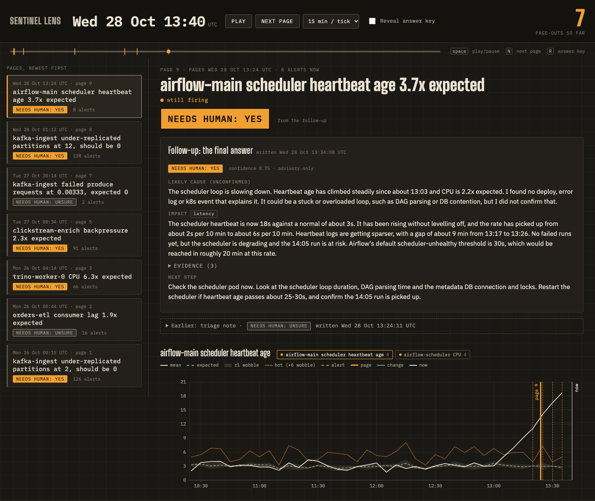
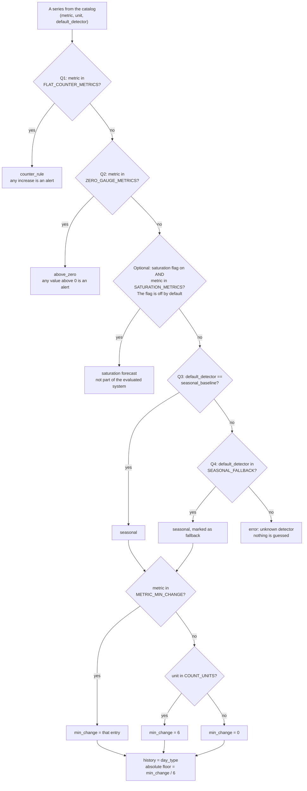

# Sentinel Lens

Anomaly detection for a data platform, built so that every alert can be explained and every
threshold defended. A statistical detector pages an engineer. An LLM agent triages each page.
A second LLM agent attacks the system with incidents it invents.



## The problem

A data platform (Kafka, Spark, Trino, Flink and Airflow on Kubernetes) produces hundreds of metrics,
and simple alerting on them is noisy: a naive detector on this project's data raises about 125 alerts
a day, three quarters of them false. People stop reading alerts like that. The goal here is to catch
real incidents early, page an engineer rarely for things that are not incidents, and say in plain
language why each alert fired ("memory is 1.3x expected for this time of day").

## Results at a glance

The system was frozen and evaluated three times, each time on data it had never seen. Each time the
protocol and my predictions were committed first, the run was done once, and the output was saved
unedited.

| | Test week (batch) | Live week 1 (Kafka stream) | Live week 2 (Kafka stream + agents) |
|---|---|---|---|
| Incidents | 10 from the simulator | 14 scripted injections | 11 invented by the attacker agent |
| Detected | 9 of 10 | 12 of 14 | 9 of 11 (Wilson 95%: 0.52-0.95) |
| False pages per day | 1.14 (1.57 with live timing) | 0.57 | 0.29 |
| Median time to detect | 13 min (scorer's timing) | 12 min | 15 min |
| Triage agent, true pages | - | (development set) | 10 of 11 answered "needs a human", 0 dangerous "no", same answers in 3 runs |

The naive detector also found all 10 test-week incidents, but with 641 false alerts. The final
system had 45 false alerts and 8 false pages. The weak spot is slow memory leaks: missed twice in
live week 1, and again in live week 2. Details, limits and what did not work are below.

## How it works

```
                      attacker agent (LLM) --control--> injector
                                                            |
 simulated world --> publisher --telemetry (Kafka)--> engine: router -> detectors -> alert record -> correlator -> feedback
                                                                                                              |
                                                                        pages <-------------------------------+
                                                                          |
                                                    triage agent (LLM, one per page) --> note: needs a human? why?
```

The detection side (router to feedback) has no LLM in it. It is plain statistics, so every alert is
explained by numbers and every threshold was chosen on training data. The two agents sit on either side
of it. The attacker is there to make the tests harder, and the triage agent to make each page quicker to act on.
Neither can change what the detector does.

**Simulator** (`sentinel_sim/`). There is no real cluster. A generator produces 28 days of 1-minute
telemetry for a simulated platform: 164 metric series, logs, job runs, and 23 injected incidents with
ground-truth labels. Detectors read it only through `DataSource`, which has a clock: nothing after
"now" is visible, so no detector can use the future. See [docs/dataset.md](docs/dataset.md).

**Router** (`sentinel_lens/router.py`). Decides which rule scores each series, from the metric name
and the series catalog, and with which settings. One detector for everything does not work: a restart
counter, a queue length and a CPU reading need different treatment. The flowchart is under
"Reference" near the end.

**Detectors** (`sentinel_lens/detectors/`).

- *Seasonal baseline with persistence* (`seasonal.py`, `persistence.py`). Each 5-minute reading is
  compared with the same time of day on the last 5 days of the same type (weekday or weekend). The
  median of those is "expected"; the typical spread around it is the "wobble" (1.4826 x the median
  absolute deviation, never less than 5% of expected or a per-metric minimum). A reading more than 6
  wobbles from expected is "hot", and an alert fires only when 3 of the last 5 readings are hot, so
  a single blip stays quiet.
- *Guardrail rules* (`guardrails.py`). Some things are always bad and need no baseline: a pod
  restart, a failed Flink checkpoint, an under-replicated Kafka partition. Any increase of those
  counters, or any value above zero, alerts at once, on 1-minute readings.
- *Schedule watcher* (`schedule.py`). A paused job produces no metric at all, so the only signal is
  a run that should have happened. It alerts when a scheduled run has not started 10 minutes after
  its time, has not finished by its SLA, or failed.
- *Job-run baseline* (`job_runs.py`). A run can succeed, inside its SLA, and still take twice as
  long as usual. Each finished run's duration is compared with that job's own earlier runs, using
  the same expected-and-wobble maths.

**Alert record** (`sentinel_lens/alerts.py`). Every detector's output becomes one record: time,
target, detector, score, direction, explanation. The score is severity (how far past its alert line
the reading is), not the probability that the alert is real; rules that are always bad score 1.0.

**Correlator** (`sentinel_lens/correlator.py`). One problem raises many alerts, and an engineer
should be paged once. Two alerts are linked when they are at most 15 minutes apart *and* their
entities are at most one step apart in the platform's relationship graph (a pod and its consumer
group, say). A connected group of alerts is one page.

**Feedback** (`sentinel_lens/feedback.py`). Labels ("real" / "false") are counted per kind of alert,
for example (seasonal, cpu_throttling). When a kind has at least 10 labels and fewer than about one
in four is real, it is demoted: its alerts stay attached to pages as context, but a page made only
of demoted alerts no longer pages anyone. Labels are simulated from the scorer's verdicts.

**Streaming engine and Kafka** (`sentinel_stream/`). The same detectors, run one minute at a time on
a Kafka topic (Redpanda in Docker) instead of a batch file. Replayed over the test week, the engine
produces exactly the batch pipeline's alerts. It writes each alert and page event once, even when the
consumer is killed and restarted (`pytest -m kafka` checks both).

**Injector** (`sentinel_stream/injector.py`). Changes the stream's readings while it runs. It offers
seven named failure scenarios, plus generic effects on any series (add or multiply; flat, ramp or decay).
Every effect is checked against what the series can physically be: a ratio stays in 0-1, memory stays
under the pod's limit, a counter only goes up. What was injected goes to a hidden `answer_key` topic.
The engine never reads that topic; only the scorer does.

**Triage agent** (`sentinel_stream/investigator.py`, `dispatcher.py`). When the engine pages, one fresh
Claude agent investigates that page. It sees what existed at paging time, through read-only tools:
the page's alerts, metrics, topology, logs, Kubernetes events, recent changes and consumer lag. The same
tools are also served over MCP. It writes a note: does this need a human (yes / no / unsure), cause,
impact, evidence and next step. Ten minutes later it writes one follow-up. Choices I can defend:
- **Advisory only.** The note never changes paging, so a wrong note cannot hide an incident.
- **A guard in code, not only in the prompt.** "No" is accepted only when the agent names a cause and
  sees no impact; otherwise it becomes "unsure". It was added after the agent answered "no" on two
  real crash loops in development.
- **Hard budgets per page** (tool calls, time, tokens), and the cost is reported.
- **Frozen before evaluation** (tag `triage-freeze-v1`). A test fails on any change to its prompt,
  tools or code.

**Attacker agent** (`sentinel_stream/attacker.py`). A second Claude agent invents incidents during a
campaign, through the injector's tools. It is woken every simulated hour and decides whether to inject.
An injection is either a named scenario or its own combination of effects. It is blind to the detector: it never reads alerts, pages, triage notes or
the answer key, and tests check that both in the code and through the broker. Its budget is enforced in
code:
- 1-3 injections a day, starting at least 3 h apart;
- it must look at a series' normal behaviour before touching it;
- named scenarios may be at most 60% of the campaign, so it has to invent.

A campaign is recorded once and replayed exactly for scoring. Frozen as `attacker-freeze-v2`.

**Dashboard** (`dashboard/`). A replay of live week 2 in one static page: the clock, the pages as they
fired, the triage agent's answer, and the chart behind each page. It never shows anything the system
could not have known at the clock. That rule lives in one tested function, `ui_state(t)`, with a JS
port that is tested to give identical output. It was chosen from three builds of one design spec:
[docs/dashboard-compare/](docs/dashboard-compare/README.md).

## How it was evaluated

Every evaluation follows the same discipline. Tune only on data already seen, freeze the code with a
git tag, commit the protocol and my predictions, run once, and save the output unedited. Anything worked
out after seeing a result goes in a separate file marked post-hoc. That held for:
- the test week, below;
- [live week 1](docs/live-protocol.md), on a second generated world;
- [live week 2](docs/live-week-2-protocol.md), on a third world, with both agents.

For the test week:

- **Split by date.** Sep 28 - Oct 4 is a warm-up week with no incidents. Oct 5 - 18 is the train
  period (12 incidents). Oct 19 - 25 is the test week (11 incidents, 10 of them actionable; the
  other is an expected traffic burst).
- **Tuned on train only.** Every method and threshold was chosen on the train period.
  [docs/log.md](docs/log.md) records each step with its numbers, including the ones that failed.
- **Frozen before the test.** The code and every parameter were frozen at the git tag
  `pre-test-freeze` ([docs/config-frozen.md](docs/config-frozen.md)), and the protocol was written
  first: which systems, which metrics, and what would not be done after seeing the numbers
  ([docs/test-protocol.md](docs/test-protocol.md)).
- **Predictions, then one run.** The author's predictions were committed, then the test week was
  run once. The runner's output was saved unedited to
  [docs/results/test-week.md](docs/results/test-week.md). Everything written after that is marked
  post-hoc and kept in a separate file.
- **One disclosed exposure.** One test-week label row (INC-014) was seen by accident on Nov 10,
  before the minimum change for CPU throttling (0.18) and its injection test were chosen. It is
  reported separately below; the full note is in the protocol.

## Results on the test week

Five systems were scored. System 5 was named the primary system in advance.

| System | Alerts per day | Per-alert precision | Incidents detected (of 10) | Wilson 95% interval | Pages | False pages per day |
| --- | --- | --- | --- | --- | --- | --- |
| 1. Naive baseline | 124.6 | 0.256 | 10 | 0.72 - 1.00 | - | - |
| 2. Seasonal baseline on everything (first build) | 87.6 | 0.294 | 9 | 0.60 - 0.98 | - | - |
| 3. Final alerts | 38.6 | 0.742 | 9 | 0.60 - 0.98 | - | - |
| 4. Final alerts + correlator pages | 38.6 | 0.742 | 9 | 0.60 - 0.98 | 26 | 1.43 |
| **5. Final + pages + frozen feedback (primary)** | 32.0 | 0.79 | 9 | 0.60 - 0.98 | 24 | 1.14 |

Source: [docs/results/test-week.md](docs/results/test-week.md), the pre-registered run. Alerts are
counted after the scorer's 30-minute dedup; "frozen feedback" means the kinds of alert demoted by the
train labels stay demoted for the whole test week and nothing is learned from it.

- **Headline.** The primary system detected 9 of 10 actionable incidents (Wilson 95% interval
  0.60 - 0.98), with per-alert precision 0.79 and 1.14 false pages per day (8 false pages in 7 days,
  out of 24 pages).
- **The miss.** INC-015, a Trino saturation, was missed by systems 3 - 5. The naive baseline caught it.
- **Without INC-014.** That incident, the one whose label was seen beforehand, was detected. Leaving
  it out, the primary system detected 8 of 9.
- **Feedback, before vs. after.** Per-alert precision 0.742 to 0.79, false pages 10 to 8. No
  incident stopped paging because of feedback.
- **Pages.** 1,445 raw alerts became 26 pages (24 after feedback). No page covered two labeled
  incidents; a labeled incident was spread over 1.6 pages on average.
- **Both incident types that never occurred in train** (a scheduler stall and broker GC pressure)
  were detected. Source: the scenario column in test-week.md (INC-020, INC-023), against the train
  list in [docs/dataset.md](docs/dataset.md).

False alerts per system:

| System | Alerts | True | Expected (non-actionable incident) | False alerts | False pages |
| --- | --- | --- | --- | --- | --- |
| 1. Naive baseline | 872 | 221 | 10 | 641 | - |
| 2. Seasonal baseline on everything | 613 | 177 | 10 | 426 | - |
| 3. Final alerts | 270 | 193 | 10 | 67 | - |
| 4. Final alerts + pages | 270 | 193 | 10 | 67 | 10 |
| 5. Final + pages + frozen feedback | 224 | 169 | 10 | 45 | 8 |

Source: [docs/results/test-week-posthoc.md](docs/results/test-week-posthoc.md), section d. **This
table is post-hoc**: it was computed after the result was seen, from the same alerts, because the
pre-registered output printed precision but not the counts.

**Time to detect.** The slowest detection was 405 minutes (INC-013, a memory leak), for systems 2 - 5.
The pre-registered table shows a median of 13.0 minutes for systems 3 - 4 and 10.0 for system 5, but
those two numbers were timed differently (after the scorer's dedup, and on raw alerts). Timed the
same way the systems are identical for every incident: 13.0 by the scorer's timing, 10.0 on raw
alerts. Feedback changed no time to detect. Source: test-week.md for the two medians,
test-week-posthoc.md section c for the like-for-like comparison.

**Correction (Nov 16): live timing.** The times and page counts above are batch numbers. Replayed one
minute at a time through the streaming engine, the same alerts fire but are known later: system 5's time
to detect is median 13.0 min and maximum 409 min (pre-registered: 10.0 and 405), and the engineer is paged
29 times, 11 of them false, which is 1.57 false pages per day (pre-registered: 1.14, from the 24 pages left
at the end of the week). No incident changes between detected and missed. Post-hoc: [Live timing](docs/results/test-week-posthoc.md#live-timing-post-hoc-streaming-engine).

**Predictions against the result.**

| Predicted before the run | Result |
| --- | --- |
| Recall 70 - 100% | 9 of 10 |
| INC-014 pages (60/40 that it does) | it paged |
| False pages per day: 1 - 2 | 1.14 |
| Median time to detect: 7 - 12 min | 10.0 on raw alerts, 13.0 by the scorer's timing |
| Maximum time to detect: 45 - 75 min | 405 min: far outside |
| Feedback removes 0 - 2 false pages | 2 |
| False volume ordering 5 <= 4 < 3 < 2 < 1 | 8 <= 10 < 67 < 426 < 641 |

Source: predictions in [docs/test-protocol.md](docs/test-protocol.md); results from the two files
above (the ordering from the post-hoc table).

## What did not work (and was left out)

- **Saturation forecast.** A line fitted to the last hour of memory, alerting when the limit would
  be reached within 4 hours. It was built and tested, and it was never faster than the seasonal
  baseline on a leak: 330 minutes against 75 on the train leak (INC-007), and, checked afterwards on
  the test leak (INC-013), 800 against 405. A slow leak is "unusual" long before it is "about to run
  out". It is in the code, switched off. Sources: docs/log.md, "Nov 10, saturation forecast";
  test-week-posthoc.md section b (exploratory).
- **Change point detector.** A CUSUM on the seasonal z-score, meant to catch small sustained shifts.
  On train it raised 517 alerts, 5 of them true. The method assumes a quiet series gives independent
  noise of about one wobble; the real scores are wider (standard deviation 1.1 - 1.6) and correlated
  from one reading to the next (0.2 - 0.33), so ordinary drift looks like a shift. It was not
  adopted; the code is on the branch `change-point`. Source: docs/log.md, "Nov 11, change point
  detector (not adopted)".

## A second world: the scripted live week

The test week is used up, so the same frozen system was run once on a second world: a generated week
with no incidents, streamed through Kafka, into which 14 failures were injected (seven scenarios,
twice each, at seeded random times and sizes). The scenarios, their ranges, the schedule and the
scoring rule were committed before the run ([docs/live-protocol.md](docs/live-protocol.md)); the
result is saved as the runner wrote it ([docs/results/live-week-1.md](docs/results/live-week-1.md)).

| | |
|---|---|
| injections detected | 12 of 14 |
| missed | both Flink state leaks (no alert at all in 6 hours each) |
| time to detect, median / maximum | 12 min / 132 min |
| pages sent | 29: 25 for an injection, 4 false |
| false pages per day | 0.57, the same 4 pages the week has with nothing injected |

How to read it:

- **The slow-leak limitation is confirmed.** The Flink leaks added 16-23% to TaskManager memory in
  their 6 hours and never alerted. The consumer leaks were paged after 116 and 132 minutes, when
  memory was 30-40% above its usual level.
- **The zero-baseline limitation did not show here.** Both Trino heavy queries were paged in 12-17
  minutes, first through the workers' GC time; the queued-queries series also alerted. These
  injections last 30-60 minutes at 0.8-1.2 of the batch scenario's size, so this does not say the
  test-week miss (INC-015) is fixed.
- **Four detections at 0 minutes say little.** The slow deploys and the crash loops restart a pod in
  their first minute, as their batch originals do, and a restart always pages. Their next signals
  came 10-14 minutes in.
- **One cause, nine pages.** The hourly DAG paused for nine hours paged once per missed run.
- 14 injections, two per scenario, one seed: counts, not rates. The injected failures are declared
  effects on the readings, not simulated physics; each scenario lists what it approximates
  (`sentinel_stream/scenarios_live.py`).

## A third world: live week 2, the whole system against an attacker agent

The frozen detector, triage agent and attacker ran together once, on a new quiet world (seed 13): one
week streamed through Kafka. The attacker's campaign was recorded and replayed for scoring, and the
triage agent ran three separate times on every page. The result is saved as the runner wrote it:
[docs/results/live-week-2.md](docs/results/live-week-2.md). Total cost: USD 4.54.

**The attacker** made 11 injections over 7 days:
- 6 named scenarios and 5 incidents of its own;
- 5 it called noticeable and 6 subtle;
- at a cost of USD 2.61.

**Detection.** 2 false page-outs in 7 days (0.29 a day, exact Poisson 95%: 0.03-1.03). Both also page
with nothing injected, so they are the quiet world's own noise.

| Injections | n | Detected | Wilson 95% | Median time to detect |
|---|---|---|---|---|
| All | 11 | 9 | 0.52-0.95 | 15 min |
| Named scenarios | 6 | 4 | 0.30-0.90 | 6 min |
| The attacker's own | 5 | 5 | 0.57-1.00 | 19 min |
| Noticeable | 5 | 5 | 0.57-1.00 | 14 min |
| Subtle | 6 | 4 | 0.30-0.90 | 20 min |

**Triage.** The scoring rule: on a real incident, "no" is dangerous and "unsure" is deferred. A false
page is correct when answered "no". The final answer is the follow-up's.

| Triage, per run (3 runs) | Result |
|---|---|
| Real pages (11): "needs a human: yes" | 10 in every run (Wilson 95%: 0.62-0.98) |
| Real pages: "no" (dangerous) | 0 in every run |
| Real pages: "unsure" | 1 in every run |
| False pages (2): "no" | 0; both "unsure" in every run |
| Same final answer in all 3 runs | 13 of 13 pages |
| Time to the final answer | median 0.5 min; max 10.4 min (waiting for the follow-up) |
| Cost per run | USD 0.53-0.81 |

How to read it ([post-hoc analysis](docs/results/live-week-2-posthoc.md), written after the result):

- **The two misses.**
  - A paused DAG (`customer_agg`, paused 14:00-19:00) had nothing to detect. The job runs once a day
    at 03:30, so no run was due during the pause.
  - A Flink state leak is the known slow-leak weakness again. It peaked at z +4.7 and +4.8, against a
    threshold of 6. With the wobble's 5% floor, memory has to be about 30% above expected to alert,
    which takes 8-10 h at that rate. The leak lasted 7.
- **The attacker's own incidents were all caught, but they were loud.** They touched 5-9 series each,
  at z 10-54. An agent that invents incidents does not automatically make them subtle.
- **The triage agent never dismisses a false page.** The guard accepts "no" only with a named cause.
  The agent could not name a cause for quiet-world noise, so both false pages ended "unsure". In
  development, none of the 4 false pages ended "no" either. So far the agent adds context to real pages; it does
  not yet reduce how many pages an engineer has to look at.
- **Predictions.** Six of my seven predictions fell outside their ranges, all on the good side: more
  detected, fewer false pages, more correct triage, lower cost. Every point prediction still lies
  inside the result's 95% interval. With 5-11 cases per group, this week cannot tell my predictions
  from the outcome; the ranges were too narrow.
- **The development set.** Before freezing, the triage agent was iterated on live week 1. Its last
  version got 23 of 25 real pages right with 0 dangerous answers. That week had been seen, so this is
  a development number, not a held-out one
  ([docs/results/triage-dev-week-1-v3.md](docs/results/triage-dev-week-1-v3.md)).

## Limitations

- **Quiet, low-count series (INC-015).** The missed incident showed up on a queue length that sits
  at zero and rose by about 22 queries. Count-like series must move by more than 6 units to be hot;
  that left 2 hot readings out of 9, and an alert needs 3 of 5. The same 6-unit rule removed
  hundreds of false alarms on train, so this is a trade-off, not a bug.
- **Slow leaks (INC-013, and the Flink leaks in both live weeks).** INC-013 was detected only after
  405 minutes. With the 5% floor, memory must be 30% above expected to be hot; it was 10% above after
  55 minutes. The naive baseline, which has no floor, alerted after 190. All three Flink state leaks in
  the live weeks were missed. This is the system's clearest weakness.
- **Small samples.** 10, 14 and 11 incidents. One incident is ten points of recall, and the interval
  for 9 of 10 runs from 0.60 to 0.98. Differences of one incident between systems mean nothing.
- **Simulated data only.** Nothing was run against a real cluster. The live weeks are independent
  worlds (new seeds), but their failures are declared effects on the readings, not simulated physics.
  An attacker's "subtle" incident is only as subtle as the effects it chose.
- **The scorer's entity rule.** An alert counts as true only if it is on a series or entity the
  incident's label lists. Alerts on closely related things (throttling on the consumer pods during a
  consumer-lag incident whose label names the consumer group) count as false. This lowers measured
  precision and is also what taught the feedback loop to demote throttling alerts.
- **Feedback is simulated.** Labels come from the scorer, not from people, and two weeks of them is
  little: two kinds of alert were demoted.
- **Triage reduces no work on false pages.** The code guard that removed dangerous "no" answers also
  means a false page can only be dismissed with a named cause, and so far none has been. The agent's
  answers also vary from run to run. In live week 2 the three runs agreed on all 13 pages, but in
  development the same agent and the same pages gave different answers on two pages. Strictly scored,
  the cause text of a named-scenario page never named the injected target (0 of 5 in each run). The
  note's own list of affected entities did, on 14 of 15 pages; the strict rule reads only the cause.
- **One attacker campaign.** Its own incidents were all caught, but they were loud. In a dry run, its
  "new" incident was a named scenario rebuilt from primitives. A cap on named scenarios forces it to
  invent, but nothing forces it to invent something hard.
- **Not built.** The scope note also lists anomaly detection on logs and one ML method as a comparison.
  Neither exists. (The triage agent reads logs, but nothing detects on them.)

Sources:
- test-week-posthoc.md sections a - c, for the two test-week incidents;
- live-week-2-posthoc.md sections 3 and 4, for the leak and target naming;
- triage-dev-week-1-v3.md (arm E), for run-to-run variation;
- docs/log.md: "Nov 10, router diagnosis" (entity rule), "Nov 11, feedback loop" and "Nov 17, an
  attacker agent" (dry run 1);
- [docs/scope-v3.md](docs/scope-v3.md), for the scope.

## Next steps

- **Fix the slow-leak miss, then test it on a fourth world.** All three evaluation worlds are now
  seen. A fix, for example a trend rule next to the seasonal one, has to be judged on a new seed with
  its own protocol, and on its false pages as well as its catches.
- **Let triage dismiss noise safely.** For example, compare a page with how often the same alert
  fired in the past weeks. Measure on a held-out week whether false pages can be answered "no" without
  any real one becoming dangerous.
- **A harder attacker.** Reward the attacker for injections the detector misses, scored after the
  campaign, without letting it see detection while it plays.
- **Real data.** The detectors read only through `DataSource`. A Prometheus adapter behind the same
  interface is the step to a real cluster.

## Reference: the router, as a flowchart

The first "yes" wins. Names are the constants in `sentinel_lens/router.py` (the two metric lists
live in `sentinel_lens/detectors/guardrails.py`).



| Constant | Value | Series it catches |
| --- | --- | --- |
| `FLAT_COUNTER_METRICS` | `kube_pod_container_status_restarts_total`, `flink_job_restarts_total`, `flink_checkpoint_failures_total` | 27 |
| `ZERO_GAUGE_METRICS` | `kafka_under_replicated_partitions` | 1 |
| `SATURATION_METRICS` (flag off) | `container_memory_working_set_bytes` | 0 while the flag is off |
| `default_detector == seasonal_baseline` | throughput, CPU, throttling, error rates | 60 |
| `SEASONAL_FALLBACK` | `saturation_forecast`, `change_point`, `guardrail` | 76 |
| `METRIC_MIN_CHANGE` | `container_cpu_throttled_ratio`: 0.18 | 25 |
| `COUNT_UNITS` | count, queries, tasks, messages, partitions, queries/min, tasks/min | 7 seasonal series |

"Fallback" means the catalog asks for a detector that is not in the evaluated system (a saturation
forecast or a change point detector), so the series runs on the seasonal baseline instead.
`min_change` is the smallest change that can alert: with a threshold of 6 wobbles, an absolute floor
of 1 on the wobble means "ignore changes of up to 6 units".

Source: `sentinel_lens/router.py`; series counts and per-metric settings from
[docs/config-frozen.md](docs/config-frozen.md) ("Routing per metric").

## Setup and usage

Checked on Python 3.14 in a fresh virtual environment.

```bash
python3 -m venv .venv && source .venv/bin/activate
pip install -r requirements-dev.txt        # pandas, numpy, scipy, pyyaml, matplotlib, pytest
export PYTHONPATH=.

python -m sentinel_sim.generate --out data --seed 7   # create the dataset (about 20 s; data/ is not in git)
pytest                                                # 471 tests, about 85 s; some need data/ or data_live/ and are skipped without it
python examples/quickstart.py                         # tour of the replay API + the naive baseline on the test week
```

The agents need `pip install -r requirements-agents.txt`, which adds the Anthropic SDK, MCP and the
Kafka client, and an `ANTHROPIC_API_KEY`. The detectors, the engine and the default tests need neither.

The default `pytest` run skips four groups:
- `slow`: 12 tests replay the whole test week through the streaming engine (`sentinel_stream/`) and
  compare it with the batch pipeline. One more regenerates the dataset and checks it is byte-identical
  to the evaluated one.
- `kafka`: tests that run through a real broker (see "Run the live stream").
- `llm`: tests that call the Claude API.
- `ui`: the dashboard's browser checks.

Each group is skipped when what it needs is missing.

```bash
pytest                          # default: 471 tests, about 85 s
pytest -m slow                  # only the slow ones: 13 tests, about 95 s (needs data/)
pytest -m kafka                 # through the broker: 12 tests, about 4 min (docker compose up -d first)
pytest -m llm                   # one real triage and one real attacker wake: 2 tests, a few cents (ANTHROPIC_API_KEY)
pytest -m ui                    # the dashboard in a browser: 1 test, about 2 min (npm install in dashboard/e2e)
pytest -m "slow or not slow"    # everything: 499 tests
```

Reproducing the numbers:

```bash
python scripts/run_test_week.py        # dry run on TRAIN: the test run's code path, checked against docs/log.md
python scripts/posthoc_test_week.py    # the post-hoc analysis of the test week (read-only)
python scripts/score_router.py         # train: naive vs. first build vs. final alerts
python scripts/score_incidents.py      # train: correlator pages
python scripts/score_feedback.py       # train: feedback loop, online replay
```

The test week itself was run once with `python scripts/run_test_week.py --split test --run-once`.
The runner now refuses to do that again: a further run needs `--post-hoc "<reason>"` and is saved
to a separate file, never over the first result.

## Run the live stream

The same engine, fed from a Kafka topic instead of a function call. A publisher plays a generated
world into the topic `telemetry` at a chosen speed; a consumer runs the engine on it and writes every
alert to `alerts` and every page event to `pages`. Needs Docker.

```bash
pip install -r requirements-kafka.txt        # adds confluent-kafka, the Kafka client
docker compose up -d                         # one Redpanda broker on 127.0.0.1:19092 with its topics

# a quiet world: 35 days, no incidents. The first 28 days are history, the last 7 are streamed.
python -m sentinel_stream.quiet_world --days 35 --seed 11 --out data_live

# terminal 1: the consumer. Warms the engine up on the history before --start, then waits for telemetry.
python -m sentinel_stream.consumer --data data_live --start 2026-10-26

# terminal 2: the publisher. --speed 60 sends one simulated minute per second.
python -m sentinel_stream.publisher --data data_live --start 2026-10-26 --speed 60

# terminal 3: watch the pages arrive (use `alerts` instead of `pages` to see every alert)
docker exec -it sentinel-redpanda rpk topic consume pages --offset start -f '%v\n'
```

What to expect. This world has no incidents, so every page is a false one: over the 7 days the
system raises 14 alerts and pages 4 times. The first page is on Oct 28 at 21:29, which is 69 minutes
in at `--speed 60`; with `--speed 600` it takes 7 minutes and the whole week 17. The consumer also
prints a `PAGE ...` line for each page.

Stopping and restarting. Stop the consumer (Ctrl-C, or kill it) and start it again with the same
command: it continues where it stopped and writes no alert or page event twice. It commits a
message's offset only after that message's outputs are on the topics, and after a restart it compares
what the engine says with what is already written before sending anything (how and why:
`sentinel_stream/consumer.py`). To start over from the beginning, delete the topics:
`docker compose down -v && docker compose up -d`.

`pytest -m kafka` checks this through the broker: the test week gives exactly the in-process engine's
alerts and page events, also when the consumer is killed three times on the way.

## Run the demo

A replay of live week 2 ([result](docs/results/live-week-2.md)) in one static web page. It needs no
broker, no generated world, no API key, no build step and no Python packages. It reads the export
committed in `dashboard/demo/live-week-2/`. Any static web server will do:

```bash
cd dashboard && python3 -m http.server 8600 --bind 127.0.0.1    # open http://127.0.0.1:8600/
```

Or open the single file `dashboard/dist/sentinel-lens-week2.html` (2.6 MB, committed) directly in a browser.
It holds the page and the data. ECharts and the fonts load from their CDNs. Rebuild it with
`python dashboard/make_single.py` after changing the page or the data. A test fails if the committed file
is out of date.

Move the clock with the slider, press Play (5 min, 15 min, 1 h or 6 h of simulated time per tick), or jump
to the next page-out. The slider has a tick for each page fired so far; click one to go to that page.
The keys are space for play/pause, N for next page and R for the answer key. Every view is a link:
`?t=2026-10-30T00:30Z&page=14&reveal=1`.

- **Pages, newest first**: every page-out up to the clock, each with a one-line reason
  ("trino-worker-0 CPU 6.3x expected") and the triage agent's current answer.
- **The selected page**:
  - the reason;
  - a status line: "still firing" (an alert in the last 10 minutes) or "quiet since HH:MM UTC";
  - the answer as a badge (needs human: yes / unsure / no);
  - the triage agent's final answer card (run 1 of 3). That card is the follow-up when there was one. It
    gives cause, impact, evidence (collapsed) and next step. An unknown cause is headed "Likely cause
    (unconfirmed)".

  The earlier note sits collapsed below the final card, labelled with its own answer and time. Each note
  appears only once the agent had written it.
- **The chart**: one series of the page, as 5-minute means.
  - **The window** runs from 3 h before the page to 2 h after it, cut off at the clock, so the page is
    always in view. A "now" line marks the clock while it is inside the window.
  - **Which series**: the series that paged (the headline's) is preselected and its chip comes first.
    The other chips follow by alert strength. A dot marks series alerting in the last 10 minutes; 5
    chips are shown, with "+N more".
  - **What it shows**: for a seasonal series, the expected value, a +/- wobble band and the hot line
    (expected + 6 x wobble). Markers show the page's alerts, the page-out, and changes (deploys and the
    like, from when they were streamed).
  - The x axis is in UTC. On the first day the window reaches back before the stream, into the
    quiet-world history the engine had; a dotted line marks where the stream starts.
- **Reveal answer key** (off by default): the attacker's injections, labelled *hidden from the system*,
  and shading on the chart and the slider. It is the one view that shows the future of the clock. Everything else
  shows only what existed at the clock: `ui_state(t)` in `dashboard/data.py`, ported to
  `dashboard/shared/visibility.js`.

The expected and wobble values are recomputed with the frozen detector settings, because the engine does
not publish them. The export compares them with the numbers printed in all 705 of the engine's seasonal
alert texts, and they agree to the print rounding. To rebuild the export (needs the broker's
`live-week-2-*` topics and `data_live_2/`):

```bash
python scripts/posthoc/lw2_export_topics.py && python dashboard/export_demo.py && python dashboard/export_ui.py
python dashboard/make_single.py
```

Tests:
- `tests/test_dashboard.py`: nothing from after the clock leaks, and the page-outs equal the live scorer's.
- `tests/test_dashboard_ui.py`: the JS port gives exactly what `data.py` gives at the same clocks.
- `tests/test_dashboard_page.py`: the single file is current.
- `pytest -m ui` runs the browser checks in `dashboard/e2e/check.mjs`. Setup: `npm install` and
  `npx playwright install chromium` in `dashboard/e2e`. They check:
  - no future data;
  - the first card's answer equals the badge;
  - UTC axis labels, with the markers where the labels put them, and no gap at the start of the line;
  - page 14, then page 17 (no stale text);
  - no truncation;
  - the keyboard;
  - a full play-through.

  Results and screenshots: [docs/dashboard/](docs/dashboard/).

This page was chosen from three builds made from one spec: Streamlit, this page, and React + Vite.
Comparison: [docs/dashboard-compare/README.md](docs/dashboard-compare/README.md). The other two are on
branch `dashboard-v2`.

### Inject a failure

While the publisher runs it takes commands from the topic `control` and changes the readings it
sends from that moment on. What it injected goes to the topic `answer_key`, which the consumer never
reads (`tests/test_live_isolation.py`).

```bash
python -m sentinel_stream.injector list                                    # the seven scenarios and their ranges
python -m sentinel_stream.injector inject trino_heavy_query -p magnitude=1.0 -p duration_min=40
python -m sentinel_stream.injector stop <id>                               # end it before its duration is over
python -m sentinel_stream.live_score --data data_live                      # detected? time to detect? false pages?

# not a named scenario: your own effects (series, add|mult, flat|ramp|decay, magnitude, minutes)
python -m sentinel_stream.injector custom \
    -e "jvm_heap_used_ratio|kafka-0" add ramp 0.2 90 \
    -e "kafka_produce_request_p99_ms|kafka-ingest" mult flat 4 30 \
    --severity subtle --intent "heap creeping up on one broker"
```

Your own effects are exact (flat holds the magnitude, ramp reaches it at the end, decay starts at
it) and are checked against what the series can physically be: a ratio stays in 0-1, memory and CPU
stay under the pod's limit, counts are whole and not negative, a counter only goes up. An effect that
would break its limit on the reading it meets is rejected, with the reason, in the answer key; the
others in the same command are applied. `--severity` (noticeable or subtle) and `--intent` are your
own words about the injection: the scorer reports by them and never uses them to decide a match.

**Stream version 2** (`python -m sentinel_stream.publisher ... --stream-version 2`) also sends the
data directory's logs, Kubernetes events and changes on `telemetry`, as one batch per type per minute.
A named scenario then also writes what its failure would leave there: a crash loop's errors and
BackOff events (and silence from the pod), a deploy or rollback record, OOMKilled events, a paused
DAG's pause record and no trace of the run that did not happen (`sentinel_stream/evidence_live.py`).
Generic injections stay metrics-only, and the answer key says which kind each injection is. The engine
does not read the new types, so alerts and pages are the same as on version 1; the triage agent's
log, event and change tools read them from the stream (`dispatcher --stream-version 2`).

The scorer reads only `answer_key` and `pages`. An injection counts as detected when a page that
pages between its start and 30 minutes after its stop holds an alert on one of its target entities
or 1 hop from one. `python scripts/run_live_week.py --rehearsal` runs the whole chain once with a
dummy injection.

## Where to read more

| File | What it is |
| --- | --- |
| [docs/design-doc.md](docs/design-doc.md) | The main design decisions, each with the alternative that was rejected |
| [docs/log.md](docs/log.md) | The working log: every step, its numbers and the reasoning, in order |
| [docs/test-protocol.md](docs/test-protocol.md) | The pre-registered protocol, the disclosure and the predictions |
| [docs/config-frozen.md](docs/config-frozen.md) | Every parameter of the evaluated systems, generated from the code |
| [docs/results/test-week.md](docs/results/test-week.md) | The test-week result, verbatim from the single run |
| [docs/results/test-week-posthoc.md](docs/results/test-week-posthoc.md) | Post-hoc analysis: the miss, the slow detection, timing, false-alert counts |
| [docs/live-protocol.md](docs/live-protocol.md) | The protocol of the scripted live week: scenarios, ranges, schedule, scoring rule |
| [docs/results/live-week-1.md](docs/results/live-week-1.md) | The live-week result, as written by the single run |
| [docs/live-week-2-protocol.md](docs/live-week-2-protocol.md) | Live week 2: frozen detector, triage agent and attacker on a new world, with predictions |
| [docs/results/live-week-2.md](docs/results/live-week-2.md) | The live-week-2 result, as written by the single run |
| [docs/results/live-week-2-posthoc.md](docs/results/live-week-2-posthoc.md) | Post-hoc: predictions vs result, the two misses, target naming, generic incidents |
| [docs/triage-config-frozen.md](docs/triage-config-frozen.md) | The frozen triage agent: model, budgets, guard, tools, the full prompt and hashes |
| [docs/results/triage-dev-week-1-v3.md](docs/results/triage-dev-week-1-v3.md) | The triage agent's development set: arms D and E, the guard, every note |
| [docs/attacker-config-frozen.md](docs/attacker-config-frozen.md) | The frozen attacker: budget (what is enforced in code), validation rules, tools, prompt |
| [docs/results/attacker-dry-run-3.md](docs/results/attacker-dry-run-3.md) | The attacker's last dry run before freezing (dry runs 1 and 2 next to it) |
| [docs/dashboard-compare/README.md](docs/dashboard-compare/README.md) | Three dashboard builds from one spec, one test script, and why the static page was chosen |
| [docs/dashboard/README.md](docs/dashboard/README.md) | The dashboard's browser checks and screenshots |
| [docs/dataset.md](docs/dataset.md) | The simulated platform, the files, the replay API and the scorer |
| [docs/scope-v3.md](docs/scope-v3.md) | The project scope |
