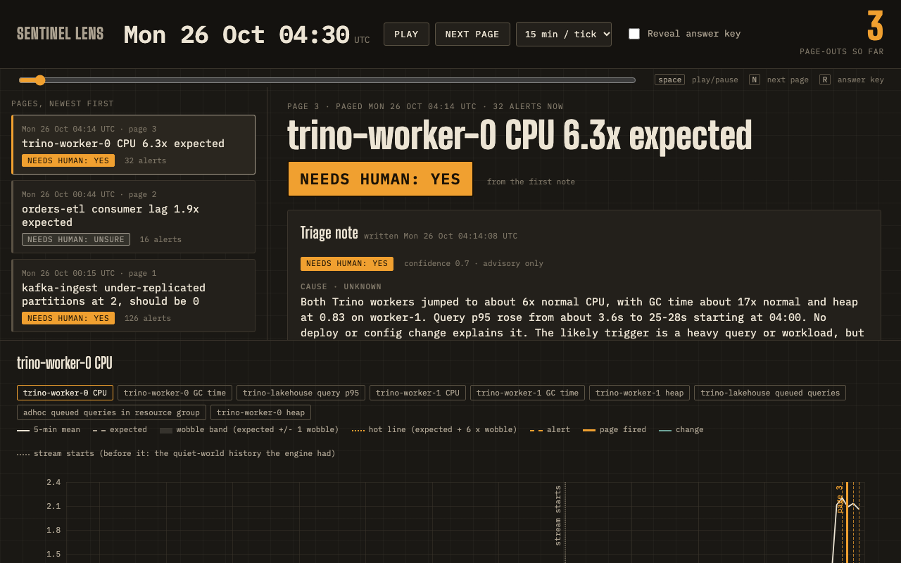
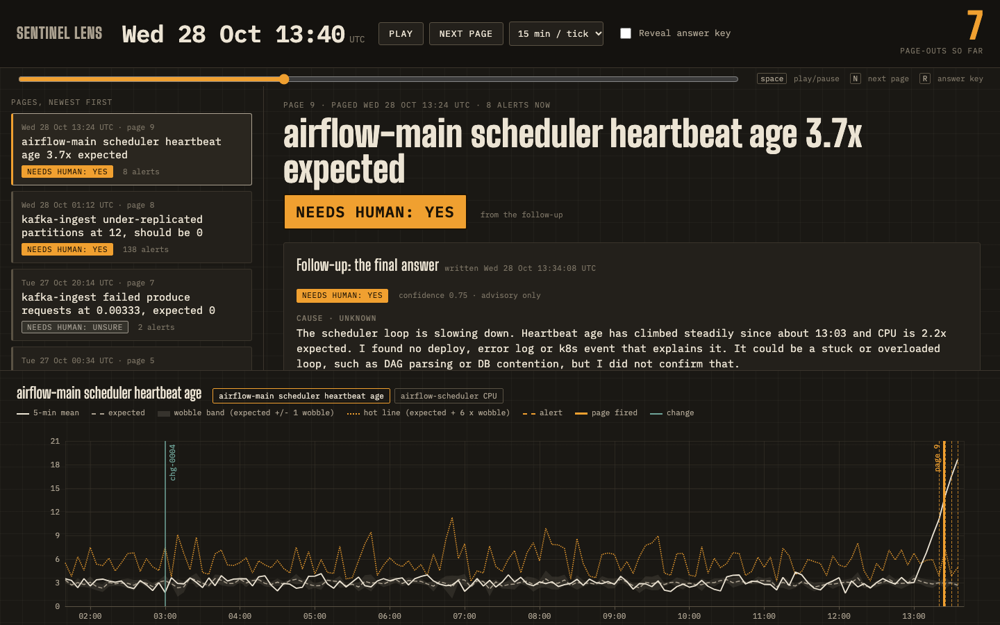
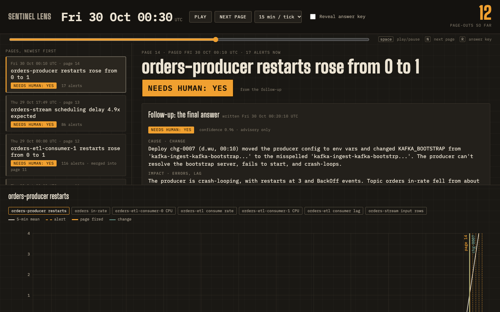
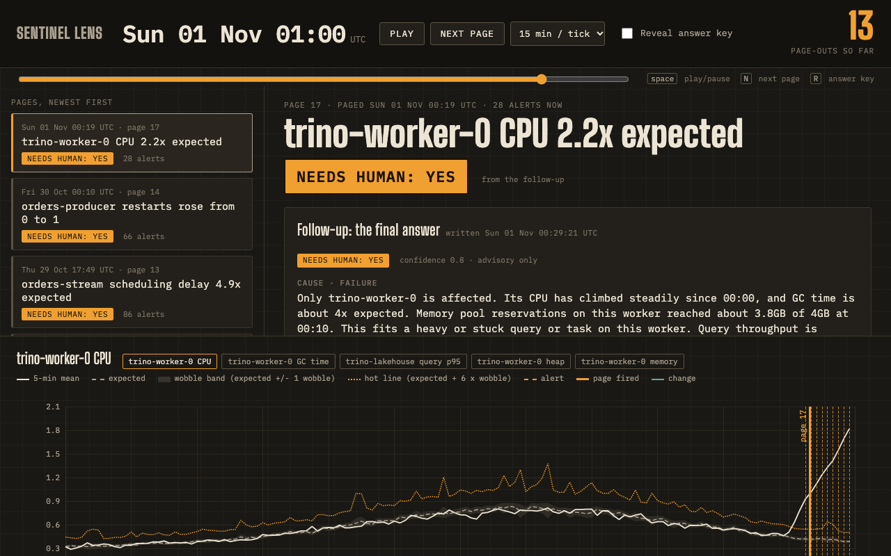

# The dashboard: browser checks and screenshots

Made by `dashboard/e2e/check.mjs` (`pytest -m ui`): Chromium, browser time zone America/Los_Angeles, on Nov 19.
Full output: [results.json](results.json). How the page was chosen: [../dashboard-compare/README.md](../dashboard-compare/README.md).

| Check | Result |
|---|---|
| No future data in the system panels (9 clocks) | pass |
| First triage card is the final answer, and its answer equals the headline badge | pass |
| Chart: x labels UTC 24 h, alert / page / change markers within 3 px of their times, line starts at the window's left edge, "stream starts" marker exactly when the stream start is in the window | pass |
| Page 14 then page 17: only page 17's notes, no chg-0007, nothing left expanded | pass |
| No truncation: 119 strings shown in full, nothing clipped | pass |
| Answer key off by default; when on, labelled "hidden from the system", all 11 injections | pass |
| Keyboard: space play/pause (also with a button focused), N next page, R answer key; hint shown | pass |
| Full play-through, 168 ticks at 1 h / tick | 67.3 s (401 ms / tick, target 400) |
| Time to first render, median of 3 cold loads (fonts and ECharts over the network) | 1296 ms |

Before the final run, two of the new checks were shown to fail on a broken page. Putting the first note on
top, instead of the final answer, failed the first-card check. Dropping the history before the stream
failed the no-gap check: the line started 809 px in.

| Clock (UTC) | 1440 x 900 | 1280 x 800 |
|---|---|---|
| Mon 26 Oct 04:30, page 3 (window reaches back before the stream) |  |  |
| Wed 28 Oct 13:40, page 9, follow-up on top |  |  |
| Thu 29 Oct 00:20, pages 11 and 12 |  |  |
| Fri 30 Oct 00:30, page 14, change chg-0007 |  |  |
| Sun 01 Nov 01:00, page 17 |  |  |
| Mon 26 Oct 04:30, answer key revealed |  | |
