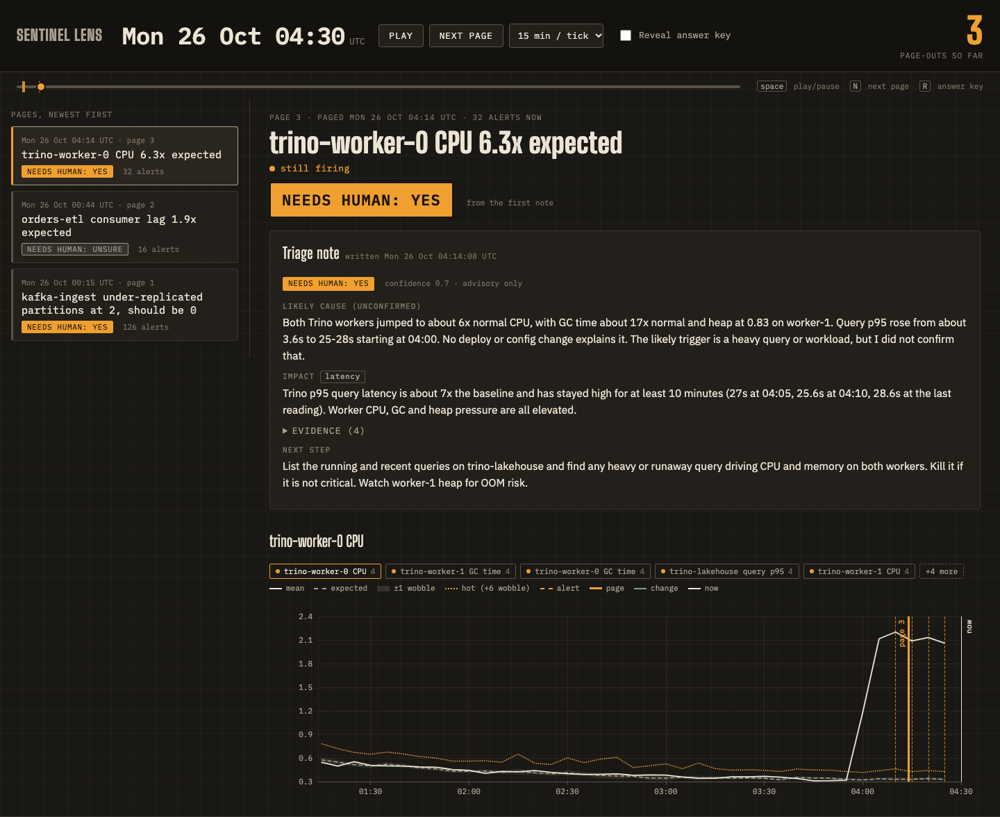
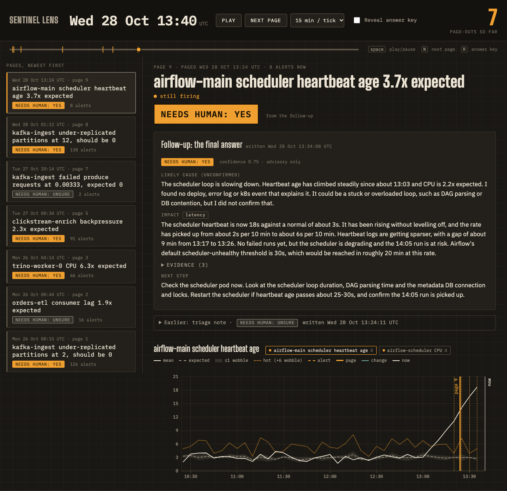
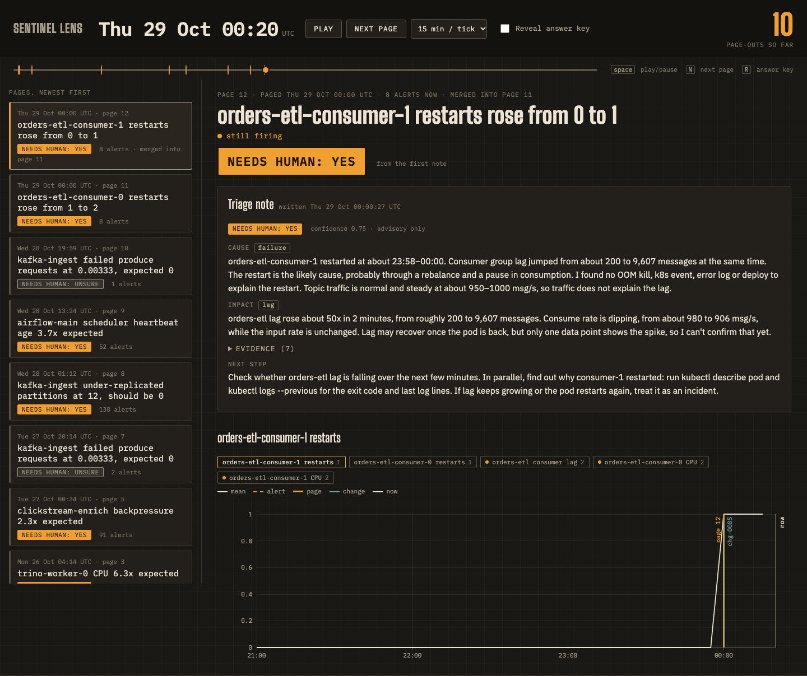
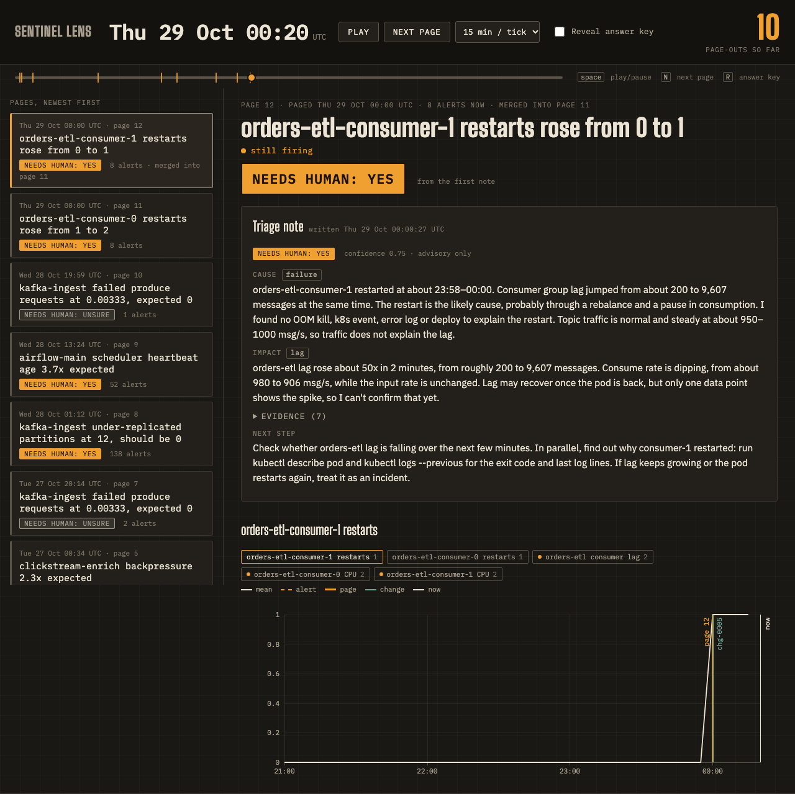
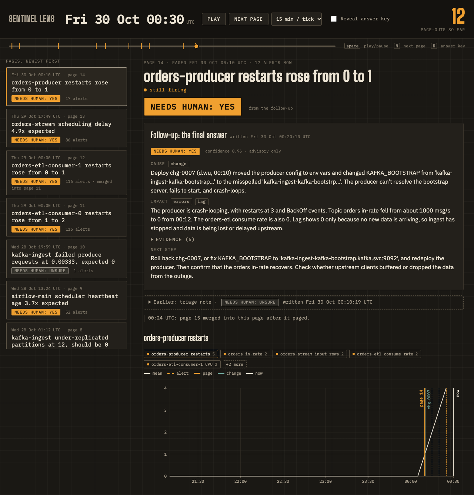
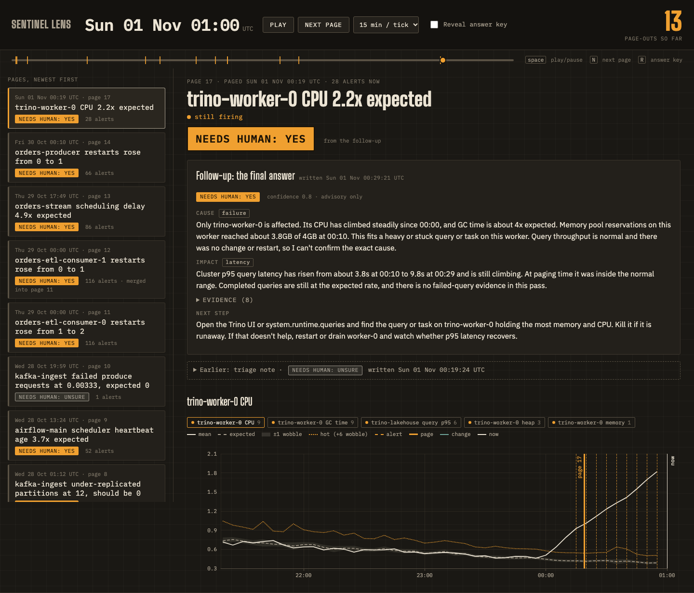
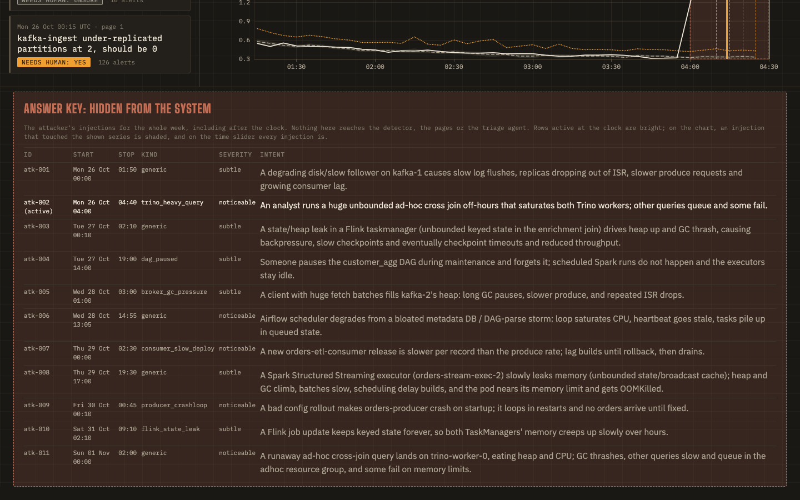

# The dashboard: browser checks and screenshots

Made by `dashboard/e2e/check.mjs` (`pytest -m ui`): Chromium, browser time zone America/Los_Angeles, on Nov 19
(branch `dashboard-ui-2`). Full output: [results.json](results.json). How the page was chosen:
[../dashboard-compare/README.md](../dashboard-compare/README.md).

| Check | Result |
|---|---|
| No future data in the system panels (9 clocks); no slider tick for a page after the clock | pass |
| First triage card is the final answer, and its answer equals the headline badge | pass |
| Chart, checked for the newest page at 9 clocks: x labels UTC 24 h; alert, page and change markers within 3 px of their times; line starts at the window's first reading; "stream starts" and "now" shown exactly when they fall in the window | pass |
| Chart window anchored on the selected page: for every page (29 selections at 3 clocks), its paging time is inside the visible x-range, the window is paged_at - 3 h to + 2 h capped at the clock, and the selected chip and charted series are the headline's (the alert that paged, from the export) | pass |
| Nothing clipped, at 1440 x 900 and 1280 x 800, in Chromium, WebKit and Firefox. The final note's last line can be scrolled into view, uncovered and not cut by any box. The legend is one line. The page-out counter is whole: as the page opens and after a scroll and reload, the boxes of the counter, its number and its label, and the measured ink of the digits and the label, all lie inside the viewport, each glyph inside its own box, and nothing covers them. | pass |
| Slider: one tick per page fired, at its time on the track; a tick click goes to that page; the answer key shades all 11 injections, and nothing is shaded with it off | pass |
| Status line ("still firing" / "quiet since HH:MM UTC") | pass |
| Series chips: the paging (headline) series first and preselected, the rest by strength; firing marks; 5 shown + "+N more" | pass |
| Cause label: "Likely cause (unconfirmed)" when unknown, else "Cause" + tag | pass |
| Typefaces: sentences in IBM Plex Sans; clock, badges and labels in IBM Plex Mono; no Inter, Roboto, Arial or Space Grotesk; headline 40 px | pass |
| Page 14 then page 17: only page 17's notes, no chg-0007, nothing left expanded | pass |
| No truncation: 119 strings shown in full, nothing clipped | pass |
| Answer key off by default; when on, labelled "hidden from the system", all 11 injections | pass |
| Keyboard: space play/pause (also with a button focused), N next page, R answer key; hint shown | pass |
| Full play-through, 168 ticks at 1 h / tick | 67.3 s (401 ms / tick, target 400) |
| Time to first render, median of 3 cold loads (fonts and ECharts over the network) | 1764 ms (2190, 1321 and 1353 in earlier runs) |

Each new check was first shown to fail on a broken page:
- The chart window put back on the clock (the original bug) failed the every-page check. For example,
  at the end of the week no page's own time was in its chart.
- A fixed-height detail box with hidden overflow failed the layout check.
- A counter line-height too small for its digits (0.5) failed the glyph-in-its-box check, and the counter pushed
  40 px up failed the inside-the-viewport check.
- Preselecting the strongest series again failed the headline-series check: on page 3 it selected
  trino-worker-1 GC time, while the headline is trino-worker-0 CPU.
- In an earlier round: the first note on top failed the first-card check, and dropping the history
  before the stream failed the no-gap check.

The layout check scrolls only what a reader can scroll: the page, and boxes with a scrollbar. Its first
version used `scrollIntoView`, which also scrolls `overflow: hidden` boxes, so it missed the fixed-height
box.

Screenshots are full pages (the page scrolls naturally), taken in a window of the size shown.

| Clock (UTC) | 1440 x 900 | 1280 x 800 |
|---|---|---|
| Mon 26 Oct 04:30, page 3 (window reaches back before the stream) |  |  |
| Wed 28 Oct 13:40, page 9, follow-up on top |  |  |
| Thu 29 Oct 00:20, pages 11 and 12 |  |  |
| Fri 30 Oct 00:30, page 14, change chg-0007 |  |  |
| Sun 01 Nov 01:00, page 17 |  |  |
| Mon 26 Oct 04:30, answer key revealed |  | |
